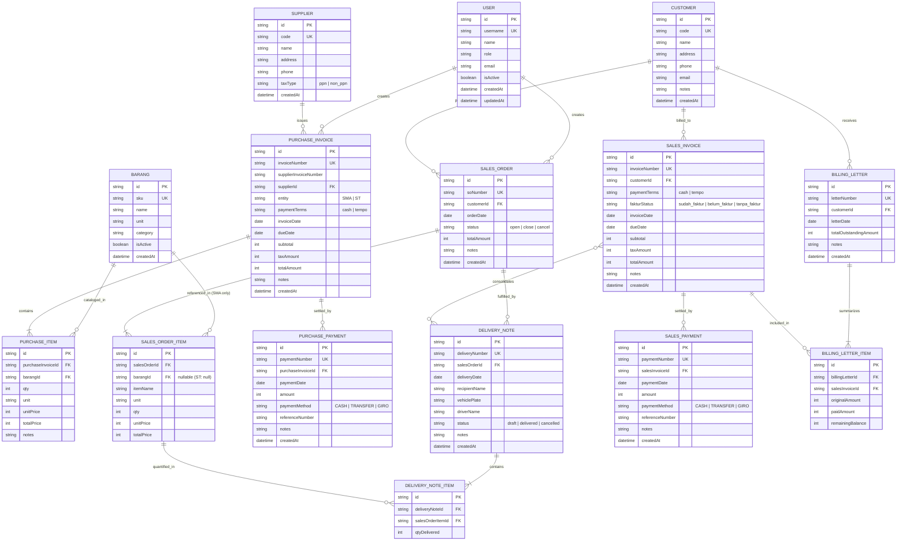

# DATA MODEL & ENTITY-RELATIONSHIP SPECIFICATION

Dokumen ini mendefinisikan struktur model data, relasi antar entitas, batasan integritas (*integrity constraints*), tipe data TypeScript, serta diagram relasi entitas (ERD) untuk aplikasi web SMA dan ST.

---

## 1. Diagram Relasi Entitas (ERD)



---

## 2. Spesifikasi Entitas & Integritas Data

### 2.1 Representasi Nilai Uang (Currency Standard)
- Semua nilai nominal uang (`subtotal`, `taxAmount`, `totalAmount`, `unitPrice`, `amount`, `remainingBalance`) disimpan sebagai **integer bulat** dalam satuan Rupiah (tanpa desimal/sen).
- Pencegahan floating-point bug: Tidak ada kalkulasi `0.1 + 0.2` dalam database/state.
- Semua operasi aritmetika menggunakan fungsi pembantu di `src/shared/utils/money.ts`.

---

### 2.2 Entitas Inti

#### `User`
Pengguna sistem dengan penugasan peran.
- `id`: string (UUID v4 / nanoid)
- `username`: string (unique, min 3 chars)
- `name`: string
- `email`: string
- `role`: `'owner' | 'admin' | 'staf_penjualan' | 'staf_pembelian' | 'keuangan' | 'viewer'`
- `isActive`: boolean (default `true`)

#### `Customer`
Pihak pembeli (klien transaksi penjualan).
- `id`: string (PK)
- `code`: string (unique, contoh: `CUST-0001`)
- `name`: string (required)
- `address`: string
- `phone`: string
- `email`: string (optional)
- `notes`: string (optional)

#### `Supplier` (*Hanya ada di SMA*)
Pemasok barang dagangan.
- `id`: string (PK)
- `code`: string (unique, contoh: `SUPP-0001`)
- `name`: string (required)
- `address`: string
- `phone`: string
- `taxType`: `'ppn' | 'non_ppn'` (required; menentukan apakah invoice supplier dikenakan PPN)

#### `Barang` (*Hanya ada di SMA*)
Katalog master barang dagangan.
- `id`: string (PK)
- `sku`: string (unique, contoh: `BRG-001`)
- `name`: string (required)
- `unit`: string (contoh: `'PCS'`, `'KG'`, `'BOX'`, `'MTR'`)
- `category`: string (contoh: `'Material'`, `'Elektronik'`, `'Alat'`)
- `isActive`: boolean (default `true`)

---

### 2.3 Entitas Modul Pembelian (*Hanya SMA*)

#### `PurchaseInvoice`
Faktur tagihan dari supplier atas pengadaan barang.
- `id`: string (PK)
- `invoiceNumber`: string (unique, format penomoran sistem: `PINV/SMA/2026/0001`)
- `supplierInvoiceNumber`: string (nomor fisik faktur dari supplier)
- `supplierId`: string (FK -> `Supplier.id`)
- `entity`: `'SMA' | 'ST'` (penanda pembelian ditujukan untuk SMA atau ST)
- `paymentTerms`: `'cash' | 'tempo'`
- `invoiceDate`: string (ISO date YYYY-MM-DD)
- `dueDate`: string (ISO date YYYY-MM-DD, wajib diisi jika `paymentTerms === 'tempo'`)
- `subtotal`: integer (total harga seluruh PurchaseItem)
- `taxAmount`: integer (PPN; dihitung otomatis jika supplier bertipe `ppn`)
- `totalAmount`: integer (`subtotal + taxAmount`)
- `notes`: string (optional)

#### `PurchaseItem`
Baris rincian barang yang diadakan dalam faktur pembelian.
- `id`: string (PK)
- `purchaseInvoiceId`: string (FK -> `PurchaseInvoice.id`)
- `barangId`: string (FK -> `Barang.id`)
- `qty`: integer (kuantitas barang, > 0)
- `unit`: string (satuan barang)
- `unitPrice`: integer (harga satuan, diketik manual oleh pengguna)
- `totalPrice`: integer (`qty * unitPrice`)
- `notes`: string (optional)

#### `PurchasePayment`
Catatan pembayaran ke supplier atas invoice pembelian.
- `id`: string (PK)
- `paymentNumber`: string (unique, format: `PPAY/2026/0001`)
- `purchaseInvoiceId`: string (FK -> `PurchaseInvoice.id`)
- `paymentDate`: string (ISO date YYYY-MM-DD)
- `amount`: integer (nominal yang dibayarkan, > 0)
- `paymentMethod`: `'CASH' | 'TRANSFER' | 'GIRO'`
- `referenceNumber`: string (nomor referensi bank/cek)
- `notes`: string (optional)

---

### 2.4 Entitas Modul Penjualan (SMA & ST)

#### `SalesOrder`
Pesanan penjualan dari customer.
- `id`: string (PK)
- `soNumber`: string (unique, format: `SO/SMA/2026/0001` atau `SO/ST/2026/0001`)
- `customerId`: string (FK -> `Customer.id`)
- `orderDate`: string (ISO date YYYY-MM-DD)
- `status`: `'open' | 'close' | 'cancel'` (default `'open'`)
- `totalAmount`: integer (akumulasi seluruh item)
- `notes`: string (optional)

#### `SalesOrderItem`
Rincian item pesanan dalam Sales Order.
- `id`: string (PK)
- `salesOrderId`: string (FK -> `SalesOrder.id`)
- `barangId`: string | null (SMA: FK -> `Barang.id`, ST: null)
- `itemName`: string (SMA: diambil dari master barang, ST: diketik bebas)
- `unit`: string (satuan kuantitas)
- `qty`: integer (jumlah pesanan, > 0)
- `unitPrice`: integer (harga jual satuan)
- `totalPrice`: integer (`qty * unitPrice`)

#### `DeliveryNote` (Surat Jalan Pengiriman Bertahap)
Dokumen pengiriman fisik barang ke customer.
- `id`: string (PK)
- `deliveryNumber`: string (unique, format: `SJ/SMA/2026/0001`)
- `salesOrderId`: string (FK -> `SalesOrder.id`)
- `deliveryDate`: string (ISO date YYYY-MM-DD)
- `recipientName`: string (nama penerima barang di lokasi)
- `vehiclePlate`: string (plat nomor armada pengiriman)
- `driverName`: string (nama sopir/kurir)
- `status`: `'draft' | 'delivered' | 'cancelled'`
- `notes`: string (optional)

#### `DeliveryNoteItem`
Kuantitas per item yang dikirim dalam suatu surat jalan.
- `id`: string (PK)
- `deliveryNoteId`: string (FK -> `DeliveryNote.id`)
- `salesOrderItemId`: string (FK -> `SalesOrderItem.id`)
- `qtyDelivered`: integer (jumlah yang dikirim dalam pengiriman ini, > 0)
- **Constraint**: `SUM(qtyDelivered untuk salesOrderItemId yang sama) <= SalesOrderItem.qty`

#### `SalesInvoice`
Faktur tagihan penjualan yang dibuat berdasarkan akumulasi satu atau beberapa Surat Jalan.
- `id`: string (PK)
- `invoiceNumber`: string (unique, format: `INV/SMA/2026/0001` atau `INV/ST/2026/0001`)
- `customerId`: string (FK -> `Customer.id`)
- `deliveryNoteIds`: string[] (array ID surat jalan yang ditagihkan)
- `paymentTerms`: `'cash' | 'tempo'`
- `dueDate`: string (ISO date YYYY-MM-DD, wajib jika tempo)
- `fakturStatus`: `'sudah_faktur' | 'belum_faktur' | 'tanpa_faktur'` (SMA: tracked, ST: selalu `'tanpa_faktur'`)
- `invoiceDate`: string (ISO date YYYY-MM-DD)
- `subtotal`: integer (total nilai item surat jalan)
- `taxAmount`: integer (PPN, 0 jika tanpa faktur)
- `totalAmount`: integer (`subtotal + taxAmount`)
- `notes`: string (optional)

#### `SalesPayment`
Catatan penerimaan uang dari customer atas sales invoice.
- `id`: string (PK)
- `paymentNumber`: string (unique, format: `SPAY/2026/0001`)
- `salesInvoiceId`: string (FK -> `SalesInvoice.id`)
- `paymentDate`: string (ISO date YYYY-MM-DD)
- `amount`: integer (nominal uang yang diterima, > 0)
- `paymentMethod`: `'CASH' | 'TRANSFER' | 'GIRO'`
- `referenceNumber`: string (nomor mutasi bank/bukti transfer)
- `notes`: string (optional)

---

### 2.5 Entitas Modul Keuangan & Surat Tagihan

#### `BillingLetter` (Surat Tagihan)
Dokumen resmi penagihan daftar piutang jatuh tempo/belum lunas kepada customer tertentu.
- `id`: string (PK)
- `letterNumber`: string (unique, format: `ST/SMA/2026/0001`)
- `customerId`: string (FK -> `Customer.id`)
- `letterDate`: string (ISO date YYYY-MM-DD)
- `totalOutstandingAmount`: integer (total sisa tagihan terakumulasi pada surat ini)
- `notes`: string (optional)
- `createdAt`: datetime

#### `BillingLetterItem`
Snapshot baris invoice yang dimasukkan ke dalam surat tagihan.
- `id`: string (PK)
- `billingLetterId`: string (FK -> `BillingLetter.id`)
- `salesInvoiceId`: string (FK -> `SalesInvoice.id`)
- `invoiceNumber`: string (nomor invoice saat surat dibuat)
- `originalAmount`: integer (total nilai awal invoice)
- `paidAmount`: integer (akumulasi pembayaran hingga surat dibuat)
- `remainingBalance`: integer (`originalAmount - paidAmount`)

---

## 3. Fungsi Derivasi Murni (Pure Business Calculations)

### 3.1 Status Pembayaran (`derivePaymentStatus`)
Status pembayaran **tidak disimpan** sebagai string yang diedit secara manual di database. Status selalu diturunkan murni dari total nilai tagihan dan riwayat pembayaran:

```ts
export type PaymentStatus = 'belum_lunas' | 'dp' | 'lunas' | 'overpaid'

export interface PaymentSummary {
  totalAmount: number
  totalPaid: number
  remainingBalance: number
  status: PaymentStatus
}

export function derivePaymentStatus(
  totalAmount: number,
  payments: Array<{ amount: number }>
): PaymentSummary {
  const totalPaid = payments.reduce((acc, p) => acc + Math.max(0, p.amount), 0)
  const remainingBalance = Math.max(0, totalAmount - totalPaid)

  let status: PaymentStatus = 'belum_lunas'
  if (totalPaid === 0) {
    status = 'belum_lunas'
  } else if (totalPaid < totalAmount) {
    status = 'dp'
  } else if (totalPaid === totalAmount) {
    status = 'lunas'
  } else {
    status = 'overpaid'
  }

  return {
    totalAmount,
    totalPaid,
    remainingBalance,
    status,
  }
}
```

### 3.2 Pemenuhan Pengiriman SO (`deriveSoFulfillment`)
Menghitung progres pengiriman surat jalan terhadap kuantitas pesanan:

```ts
export interface ItemFulfillment {
  salesOrderItemId: string
  orderedQty: number
  deliveredQty: number
  remainingQty: number
  isFullyDelivered: boolean
}

export function deriveSoFulfillment(
  soItems: SalesOrderItem[],
  deliveryNoteItems: DeliveryNoteItem[]
): {
  items: ItemFulfillment[]
  isCompletelyFulfilled: boolean
} {
  const deliveryMap = new Map<string, number>()
  for (const dni of deliveryNoteItems) {
    const current = deliveryMap.get(dni.salesOrderItemId) ?? 0
    deliveryMap.set(dni.salesOrderItemId, current + dni.qtyDelivered)
  }

  const items: ItemFulfillment[] = soItems.map((item) => {
    const delivered = deliveryMap.get(item.id) ?? 0
    const remaining = Math.max(0, item.qty - delivered)
    return {
      salesOrderItemId: item.id,
      orderedQty: item.qty,
      deliveredQty: delivered,
      remainingQty: remaining,
      isFullyDelivered: remaining === 0,
    }
  })

  const isCompletelyFulfilled = items.every((i) => i.isFullyDelivered)
  return { items, isCompletelyFulfilled }
}
```
